<h1 align="center">Olá, eu sou o Rafael Silva 👋</h1>

  <b>Tecnologia da Informação | ADS | Desenvolvimento Web</b> 
  PHP · JavaScript · SQL

  
  

---

### 🧑‍💻 Sobre mim

- 🎓 Estudante de **Análise e Desenvolvimento de Sistemas** na **Universidade Cruzeiro do Sul**
- 💼 Trabalho com **PHP, JavaScript e SQL** no desenvolvimento web
- 🔭 Projeto pessoal: **[Painel-rotina](https://github.com/9rafinh4/Painel-rotina)**, app de iPhone + painel web para hábitos, treino e sono
- 🎯 Buscando novas oportunidades na área de desenvolvimento
- 📍 São Paulo, Brasil

---

### 🛠️ Tecnologias que uso

| | Tecnologia | Como eu uso |
|:-:|---|---|
|  | **PHP** | Back-end, regras de negócio e integração com APIs |
|  | **JavaScript** | Lógica e interações de páginas web |
|  | **SQL / MySQL** | Consultas, validação e análise de dados |
|  | **HTML5** | Estrutura de páginas e telas |
|  | **CSS3** | Estilização e layouts responsivos |
|  | **Git** | Versionamento e trabalho em equipe |

---

### 📊 Estatísticas

  
  

---

### 👾 Minhas contribuições (versão Pac-Man)

  <picture>
    <source media="(prefers-color-scheme: dark)" srcset="https://raw.githubusercontent.com/9rafinh4/9rafinh4/output/pacman-contribution-graph-dark.svg">
    <source media="(prefers-color-scheme: light)" srcset="https://raw.githubusercontent.com/9rafinh4/9rafinh4/output/pacman-contribution-graph.svg">
    
  </picture>

---

### 🚀 Projeto em destaque

| Projeto | Descrição | Stack |
|---|---|---|
| [**Painel-rotina**](https://github.com/9rafinh4/Painel-rotina) | Sistema pessoal de rotina: widgets no iPhone + painel web para hábitos, treino, sono e evolução | React · TypeScript · Scriptable |

<i>Obrigado pela visita! ⭐</i>

